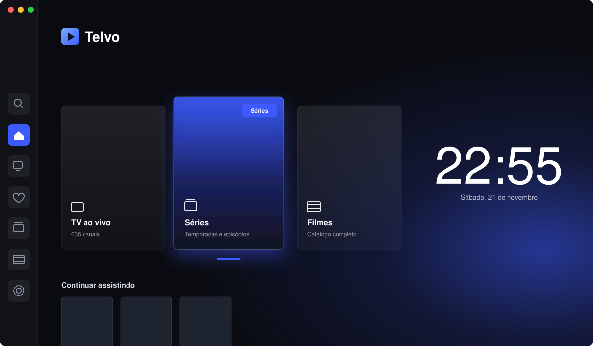

<div align="center">


# Telvo para Mac

**Sua lista IPTV com cara de app de Mac.**<br>
TV ao vivo, séries e filmes num player nativo, rápido e sem complicação.

[](https://github.com/webdevpls/telvo-mac/releases/latest)


<br>

<a href="https://github.com/webdevpls/telvo-mac/releases/latest/download/Telvo.dmg">
  
</a>

<br><br>



</div>

---

## ✨ Destaques

<table>
<tr>
<td width="33%" valign="top">

**📺 TV ao vivo**<br>
Canais por grupo, favoritos e busca. "Agora / A seguir" direto do guia (EPG).

</td>
<td width="33%" valign="top">

**🎬 Filmes e séries**<br>
Fileiras por categoria, temporadas e episódios, e **Continuar assistindo** de onde você parou.

</td>
<td width="33%" valign="top">

**▶️ Toca de tudo**<br>
VLC embutido: TS, HLS, MP4 e MKV. Reconecta sozinho quando o servidor engasga.

</td>
</tr>
<tr>
<td valign="top">

**⏸ Pausa inteligente**<br>
Pausou a TV? Ao despausar, volta para o **ao vivo**, sem ficar atrasado.

</td>
<td valign="top">

**⌨️ Feito para o Mac**<br>
Atalhos de teclado, menu na barra, botão direito e vidro fosco do macOS.

</td>
<td valign="top">

**🔗 M3U e Xtream**<br>
Cole a URL da sua lista (M3U ou `get.php` do Xtream Codes) e pronto.

</td>
</tr>
</table>

## 🚀 Instalar em 1 minuto

### Opção 1: Terminal (mais rápido)

Cole no Terminal. Instala, libera o aviso do macOS e já abre. **Serve também para atualizar.**

```bash
curl -L -o /tmp/Telvo.dmg https://github.com/webdevpls/telvo-mac/releases/latest/download/Telvo.dmg && \
hdiutil attach -nobrowse -quiet /tmp/Telvo.dmg && \
rm -rf /Applications/Telvo.app && cp -R /Volumes/Telvo/Telvo.app /Applications/ && \
hdiutil detach -quiet /Volumes/Telvo && xattr -dr com.apple.quarantine /Applications/Telvo.app && \
rm /tmp/Telvo.dmg && open /Applications/Telvo.app
```

### Opção 2: Instalador

1. Baixe o **[Telvo.dmg](https://github.com/webdevpls/telvo-mac/releases/latest/download/Telvo.dmg)**.
2. Abra o `.dmg` e arraste o **Telvo** para **Aplicativos**.
3. Na primeira vez, o macOS avisa que não consegue verificar o desenvolvedor. Libere uma única vez:
   **Ajustes do Sistema → Privacidade e Segurança → Abrir mesmo assim**.

## 👋 Primeiros passos

1. Abra o Telvo e vá em **Configurações** (⚙ na barra lateral).
2. Clique em **Adicionar lista** e cole a URL que o seu provedor enviou.
3. Pronto: o **Início** mostra **TV ao vivo**, **Séries** e **Filmes**.

> 💡 O Telvo é só o player. Ele não vem com canais nem conteúdo: use a lista do seu provedor.

## ⌨️ Atalhos

| Tecla | TV ao vivo | Filmes e séries |
|:--|:--|:--|
| <kbd>Espaço</kbd> | pausa (despausar volta ao ao vivo) | pausa / continua |
| <kbd>↑</kbd> <kbd>↓</kbd> | troca de canal | volume |
| <kbd>←</kbd> <kbd>→</kbd> | volume | volta / avança 10 s |
| <kbd>+</kbd> <kbd>−</kbd> · <kbd>M</kbd> | volume · mudo | volume · mudo |
| <kbd>F</kbd> ou clique duplo | tela cheia | tela cheia |
| <kbd>N</kbd> <kbd>P</kbd> | próximo / anterior | próximo / episódio anterior |
| <kbd>Esc</kbd> | volta | volta |

No app todo: <kbd>⌘0</kbd> Início · <kbd>⌘1</kbd> TV · <kbd>⌘2</kbd> Séries · <kbd>⌘3</kbd> Filmes · <kbd>⌘,</kbd> Configurações · <kbd>⌘R</kbd> atualizar lista.
Botão direito num canal favorita; num item de **Continuar assistindo**, tira da lista.

## ❓ Dúvidas comuns

<details>
<summary><b>O Mac diz que o app "não pode ser aberto"</b></summary>

O Telvo não é assinado com a conta paga de desenvolvedor da Apple, então o macOS pede uma confirmação
na primeira vez. Vá em **Ajustes do Sistema → Privacidade e Segurança** e clique em **Abrir mesmo assim**,
ou rode `xattr -dr com.apple.quarantine /Applications/Telvo.app` no Terminal.
</details>

<details>
<summary><b>Um canal fica carregando ou dá erro</b></summary>

O Telvo tenta reconectar sozinho algumas vezes. Se continuar, aperte <kbd>Enter</kbd> (ou **Tentar de novo**).
Canal fora do ar costuma ser do servidor da lista; teste outro canal.
</details>

<details>
<summary><b>Como atualizo para a versão nova?</b></summary>

Rode de novo o comando da **Opção 1**. Suas listas, favoritos e "Continuar assistindo" são mantidos.
</details>

<details>
<summary><b>Tem para TV?</b></summary>

Sim: o Telvo nasceu como app de **Android TV** ([nerigleston/iptv-tv](https://github.com/nerigleston/iptv-tv)),
pensado para usar com o controle remoto. Esta é a versão para Mac.
</details>

---

## 🛠 Para desenvolvedores

Requisitos: macOS 14+, Xcode 16+ e [XcodeGen](https://github.com/yonaskolb/XcodeGen) (`brew install xcodegen`).

```bash
./scripts/fetch-vlckit.sh      # baixa o VLCKit 3.7.3 da VideoLAN para Vendor/
xcodegen generate              # gera o Telvo.xcodeproj a partir do project.yml
xcodebuild -project Telvo.xcodeproj -scheme Telvo -configuration Release -derivedDataPath build build
open build/Build/Products/Release/Telvo.app
```

| Pasta | O que tem |
|:--|:--|
| `Telvo/Data` | modelos, parser M3U, cliente Xtream, EPG (XMLTV), HTTP e armazenamento. Porte do código Kotlin do app de TV |
| `Telvo/App` | `AppModel` (equivalente ao `MainViewModel`), entrada do app e monitor de teclas |
| `Telvo/Player` | `VideoPlayer` (VLCKit) e controles de pausa e volume |
| `Telvo/Views` | telas, barra lateral e tema |

<div align="center">
<br>
<sub>Feito com SwiftUI e <a href="https://www.videolan.org/vlc/libvlc.html">VLCKit</a> · baseado no <a href="https://github.com/nerigleston/iptv-tv">Telvo para Android TV</a></sub>
</div>
